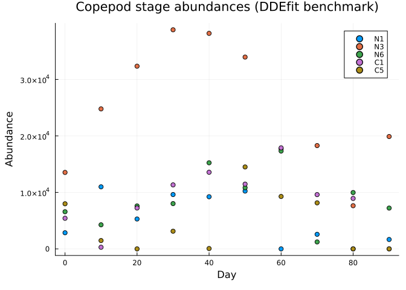
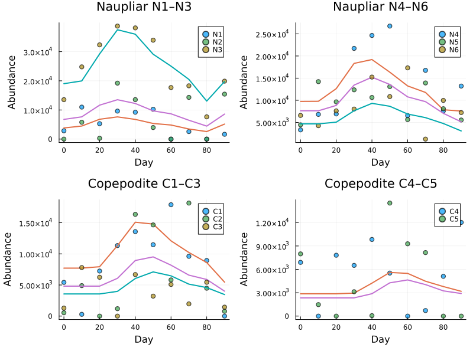
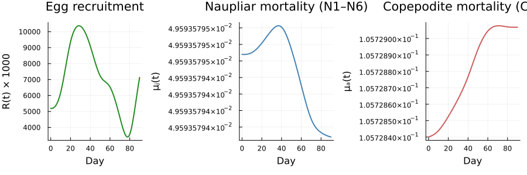
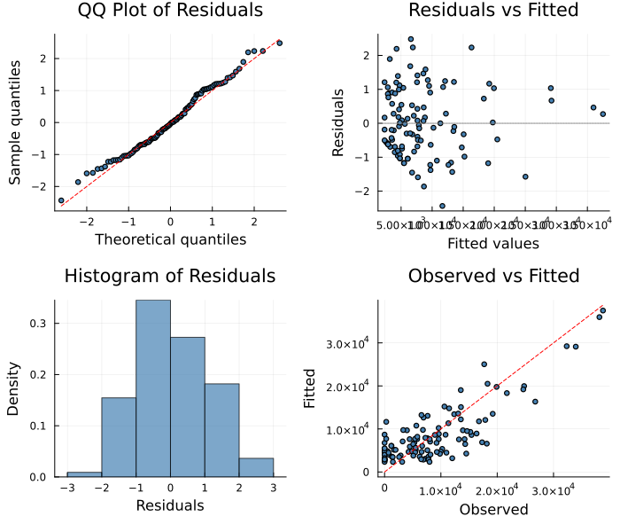

# Copepod Stage-Structured Population Model (Wood 2001 DDE)
Simon Frost
2026-11-27

- [Overview](#overview)
- [Setup](#setup)
- [Data and Stage Weighting](#data-and-stage-weighting)
- [Fixed-Duration Stage-Structured DDE
  Model](#fixed-duration-stage-structured-dde-model)
- [Strictly Positive Vital Rate
  Approximators](#strictly-positive-vital-rate-approximators)
- [Building and Solving](#building-and-solving)
- [Results](#results)
  - [Fitted Trajectories](#fitted-trajectories)
  - [Estimated Strictly Positive Vital
    Rates](#estimated-strictly-positive-vital-rates)
- [Diagnostic Plots](#diagnostic-plots)
- [Summary](#summary)

## Overview

This vignette demonstrates `PartiallySpecifiedModels.jl` on the
canonical ecological benchmark from Wood (2001): an **11-stage
fixed-duration delay-differential equation (DDE)** model of *Calanus
finmarchicus* population dynamics.

The copepod passes through 11 pre-adult developmental stages: six
naupliar stages (N1–N6) and five copepodite stages (C1–C5; adult C6 is
not included in the stage table). Fixed stage durations
$\tau_1, \dots, \tau_{11}$ are known from laboratory rearing
experiments, while three strictly positive biological vital rates are
unknown smooth functions of time:

- $R(t) > 0$ — egg recruitment rate (scaled by $1000$)
- $\mu_j(t) > 0$ — naupliar (N1–N6) per-capita mortality rate
- $\mu_a(t) > 0$ — copepodite (C1–C5) per-capita mortality rate

> **Dataset provenance**: The bundled dataset `data/cop.dat` is the
> simulated 11-stage benchmark dataset distributed with Simon Wood’s
> `DDEfit` software (10 sampling days over $[0, 90]$ days across stages
> N1–N6 and C1–C5).

## Setup

``` julia
using PartiallySpecifiedModels
using PartiallySpecifiedModels: solve
using OrdinaryDiffEq
using DelimitedFiles
using Statistics
using Plots
using Printf
```

## Data and Stage Weighting

Raw stage counts span four orders of magnitude (from `0` up to `38,783`
in N3). An unweighted Gaussian loss lets high-abundance naupliar stages
dominate the objective by $\sim 100\times$ over late copepodites.
Following Wood (2001), we weight each stage inversely by its empirical
variance so every developmental stage contributes equitably:

``` julia
data_path = joinpath(@__DIR__, "..", "..", "data", "cop.dat")
raw = readdlm(data_path)
data_times = Float64.(raw[:, 1])
data_values = Float64.(raw[:, 2:12])   # N1–N6, C1–C5

n_times, n_stages = size(data_values)
stage_names = ["N1", "N2", "N3", "N4", "N5", "N6", "C1", "C2", "C3", "C4", "C5"]

col_stds = [max(std(data_values[:, j]), 1.0) for j in 1:n_stages]
w_stage = 1.0 ./ (col_stds .^ 2)
w_stage ./= mean(w_stage)
data_weights = repeat(reshape(w_stage, 1, n_stages), n_times, 1)

println("Observations: $n_times times × $n_stages stages (N1–N6, C1–C5)")
println("Time range: $(data_times[1])–$(data_times[end]) days")
```

    Observations: 10 times × 11 stages (N1–N6, C1–C5)
    Time range: 0.0–90.0 days

``` julia
p_data = plot(xlabel="Day", ylabel="Abundance",
              title="Copepod stage abundances (DDEfit benchmark)",
              legend=:topright)
for j in [1, 3, 6, 7, 11]
    scatter!(p_data, data_times, data_values[:, j], label=stage_names[j], ms=4)
end
p_data
```



## Fixed-Duration Stage-Structured DDE Model

Following Nisbet & Gurney (1983) and Wood (1994, 2001), each stage $i$
has a **fixed residence duration** $\tau_i$ rather than an exponential
1-box rate. Let $T_i = \sum_{k=1}^i \tau_k$ be cumulative age at exit
from stage $i$, and track two auxiliary cumulative mortality integrals:

$$\frac{dL_j}{dt} = \mu_j(t), \qquad \frac{dL_a}{dt} = \mu_a(t),$$

with steady-state pre-history $L_j(t) = \mu_j(0)\,t$ and
$L_a(t) = \mu_a(0)\,t$ for $t \le 0$. An individual maturing out of
stage $i$ at time $t$ was recruited at $t - T_i$ and survived cumulative
mortality $\Lambda_i(t)$:

$$\Lambda_i(t) =
\begin{cases}
L_j(t) - L_j(t - T_i), & i \le 6, \\
\big(L_j(t - (T_i - T_6)) - L_j(t - T_i)\big) + \big(L_a(t) - L_a(t - (T_i - T_6))\big), & i \ge 7.
\end{cases}$$

The maturation flux out of stage $i$ is
$M_i(t) = R_1(t - T_i)\exp(-\Lambda_i(t))$, yielding the exact
stage-balance DDEs:

$$\frac{ds_i}{dt} = R_i(t) - M_i(t) - \mu_i(t)\,s_i(t), \qquad R_1(t) = 1000\,R(t),\quad R_i(t) = M_{i-1}(t).$$

``` julia
# Known fixed stage durations (days) for N1–N6 and C1–C5 (Wood 2001)
durations = [0.75, 1.4, 4.55, 2.8, 2.5, 1.7, 3.5, 3.1, 3.2, 3.7, 4.7]
cum_T = cumsum(durations)
T_N6 = cum_T[6]
copepod_delays = sort(unique(vcat(cum_T, [cum_T[i] - T_N6 for i in 7:11])))

@inline expm1_ratio(x) = abs(x) < 1e-8 ? (1 - x / 2 + x^2 / 6) : (1 - exp(-x)) / x

function copepod_dde!(du, u, h, p, t)
    R_t = p.R(t) * 1000.0
    μ_j = p.mu_j(t)
    μ_a = p.mu_a(t)
    du[12] = μ_j
    du[13] = μ_a
    Lj_now, La_now = u[12], u[13]
    inflow = R_t
    @inbounds for i in 1:11
        t_rec = t - cum_T[i]
        R_rec = p.R(t_rec <= 0.0 ? 0.0 : t_rec) * 1000.0
        if i <= 6
            cum_mort = Lj_now - h(p, t_rec; idxs=12)
            death = μ_j
        else
            t_trans = t - (cum_T[i] - T_N6)
            cum_mort = (h(p, t_trans; idxs=12) - h(p, t_rec; idxs=12)) +
                       (La_now - h(p, t_trans; idxs=13))
            death = μ_a
        end
        maturation = R_rec * exp(-cum_mort)
        du[i] = inflow - maturation - death * u[i]
        inflow = maturation
    end
end

function copepod_history(p, t)
    R0 = p.R(0.0) * 1000.0
    μ_j0 = p.mu_j(0.0)
    μ_a0 = p.mu_a(0.0)
    T = promote_type(typeof(R0), typeof(μ_j0), typeof(μ_a0), typeof(t))
    u = zeros(T, 13)
    inflow = T(R0)
    @inbounds for i in 1:11
        death = i <= 6 ? T(μ_j0) : T(μ_a0)
        τ = durations[i]
        u[i] = inflow * τ * expm1_ratio(death * τ)
        inflow = inflow * exp(-death * τ)
    end
    u[12] = T(μ_j0) * t
    u[13] = T(μ_a0) * t
    u
end

copepod_u0(p) = copepod_history(p, 0.0)
```

    copepod_u0 (generic function with 1 method)

## Strictly Positive Vital Rate Approximators

Using `ShapeConstrainedBSplineApproximator(..., :positive)` enforces
$R(t) > 0$, $\mu_j(t) > 0$, and $\mu_a(t) > 0$ at every point during
optimization and uncertainty quantification, ruling out biologically
impossible negative recruitment or mortality rates:

``` julia
approx_R = ShapeConstrainedBSplineApproximator(:R, (0.0, 90.0), 12, :positive;
    initial = t -> begin
        μ, σ = 30.0, 20.0
        (0.01 + 0.39894228 / σ * exp(-(t - μ)^2 / σ^2)) * 400.0
    end)

approx_mu_j = ShapeConstrainedBSplineApproximator(:mu_j, (0.0, 90.0), 12, :positive;
    initial = t -> 0.1 * exp(-0.02 * t))

approx_mu_a = ShapeConstrainedBSplineApproximator(:mu_a, (0.0, 90.0), 12, :positive;
    initial = t -> 0.1)
```

    ShapeConstrainedBSplineApproximator(:mu_a, (0.0, 90.0), 12, :positive, [1.0 0.0 … 0.0 0.0; 0.0 1.0 … 0.0 0.0; … ; 0.0 0.0 … 1.0 0.0; 0.0 0.0 … 0.0 1.0], var"#14#15"())

## Building and Solving

``` julia
prob = PSMProblem(copepod_dde!, copepod_u0, (0.0, 90.0),
    [approx_R, approx_mu_j, approx_mu_a];
    data_times = data_times,
    data_values = data_values,
    data_weights = data_weights,
    obs_to_state = collect(1:11),
    delays = copepod_delays,
    history = copepod_history,
    known_params = NamedTuple(),
    likelihood = GaussianLikelihood(),
    solver = BS3(),
    order_discontinuity_t0 = 2,
    abstol = 1e-5, reltol = 1e-5, maxiters = 10_000)

sol = solve(prob, LAML(maxiters=40, verbose=false))

println("Converged:       ", sol.convergence.converged, " ($(sol.convergence.reason))")
println("Weighted loss:   ", @sprintf("%.4e", sol.data_loss))
println("Penalized obj:   ", @sprintf("%.4e", sol.objective))
println("EDF:             ", round(sol.edf, digits=2))
println("Smoothing λ:     ", [round(s, sigdigits=4) for s in sol.smoothing_params])
```

    ┌ Warning: LAML: the objective converged but the parameters did not — one more PCLS step from the reported fit moves β by 2.03 (relative), above 0.001. The fit stopped on a flat ridge of the penalized objective: the fitted FUNCTIONS are usable, but individual coefficients and their covariance are not pinned. See `convergence.ridge` and `convergence.final_parameter_step`.
    └ @ PartiallySpecifiedModels ~/Projects/psm/PartiallySpecifiedModels.jl/src/solver.jl:2451
    Converged:       true (converged_tol)
    Weighted loss:   1.7948e+09
    Penalized obj:   1.0828e+09
    EDF:             6.61
    Smoothing λ:     [4.878e6, 6.013e15, 2.354e17]

## Results

### Fitted Trajectories

``` julia
pred = sol.fitted_values
plots_stages = []

for (stages, title) in [([1,2,3], "Naupliar N1–N3"), ([4,5,6], "Naupliar N4–N6"),
                          ([7,8,9], "Copepodite C1–C3"), ([10,11], "Copepodite C4–C5")]
    p = plot(xlabel="Day", ylabel="Abundance", title=title, legend=:topright)
    for j in stages
        scatter!(p, data_times, data_values[:, j], label=stage_names[j], ms=4, alpha=0.7)
        plot!(p, data_times, pred[:, j], lw=2, label=nothing)
    end
    push!(plots_stages, p)
end

plot(plots_stages..., layout=(2, 2), size=(800, 600))
```



### Estimated Strictly Positive Vital Rates

``` julia
t_grid = range(0.0, 90.0, length=200)

p1 = plot(t_grid, [sol.unknown_functions[:R](t) * 1000.0 for t in t_grid],
          xlabel="Day", ylabel="R(t) × 1000",
          title="Egg recruitment", lw=2, color=:forestgreen, label=nothing)

p2 = plot(t_grid, [sol.unknown_functions[:mu_j](t) for t in t_grid],
          xlabel="Day", ylabel="μⱼ(t)",
          title="Naupliar mortality (N1–N6)", lw=2, color=:steelblue, label=nothing)

p3 = plot(t_grid, [sol.unknown_functions[:mu_a](t) for t in t_grid],
          xlabel="Day", ylabel="μₐ(t)",
          title="Copepodite mortality (C1–C5)", lw=2, color=:indianred, label=nothing)

plot(p1, p2, p3, layout=(1, 3), size=(900, 300))
```



## Diagnostic Plots

``` julia
diag = psm_appraise(sol)

p_qq = scatter(diag.qq_theoretical, diag.qq_sample,
    xlabel="Theoretical quantiles", ylabel="Sample quantiles",
    title="QQ Plot of Residuals", ms=3, legend=false, color=:steelblue)
mn, mx = extrema(vcat(diag.qq_theoretical, diag.qq_sample))
plot!(p_qq, [mn, mx], [mn, mx], color=:red, ls=:dash, label="")

p_rf = scatter(diag.fitted, diag.residuals,
    xlabel="Fitted values", ylabel="Residuals",
    title="Residuals vs Fitted", ms=3, legend=false, color=:steelblue)
hline!(p_rf, [0], color=:gray, ls=:dot)

p_hist = histogram(diag.residuals, normalize=:pdf,
    xlabel="Residuals", ylabel="Density",
    title="Histogram of Residuals", legend=false, color=:steelblue, alpha=0.7)

p_of = scatter(diag.observed, diag.fitted,
    xlabel="Observed", ylabel="Fitted",
    title="Observed vs Fitted", ms=3, legend=false, color=:steelblue)
mn2, mx2 = extrema(vcat(diag.observed, diag.fitted))
plot!(p_of, [mn2, mx2], [mn2, mx2], color=:red, ls=:dash, label="")

plot(p_qq, p_rf, p_hist, p_of, layout=(2, 2), size=(700, 600))
```



## Summary

This faithful Wood (2001) copepod benchmark showcases:

- **Fixed-duration stage-structured DDEs** via `delays` and
  parameter-dependent `history`
- **Strictly positive unknown vital rates** via
  `ShapeConstrainedBSplineApproximator(..., :positive)`
- **Stage-weighted Gaussian LAML** balancing observations spanning four
  orders of magnitude across stages N1–N6 and C1–C5
