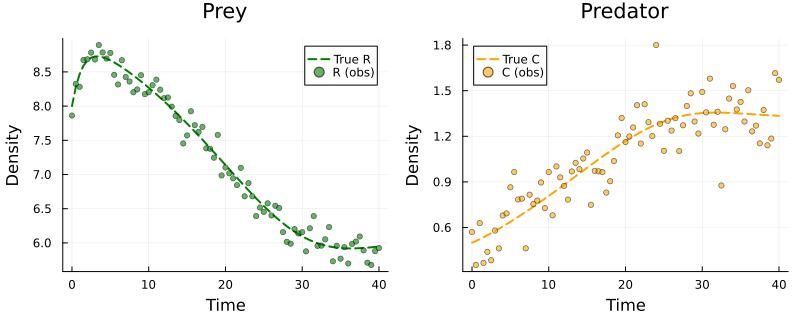
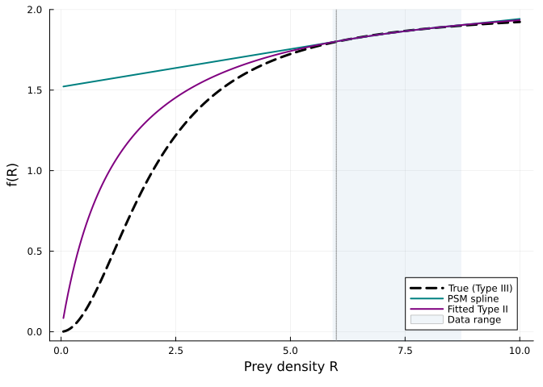
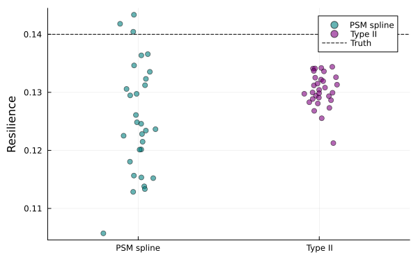
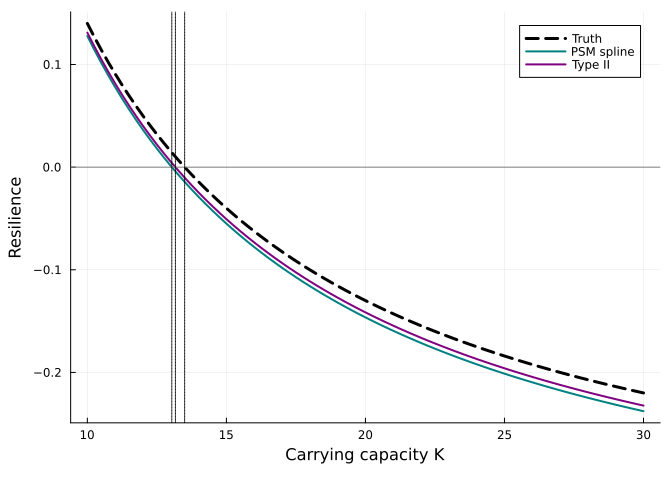

# Resilience of a Fitted Equilibrium
Simon Frost
2026-11-17

- [Overview](#overview)
- [Setup](#setup)
- [The True Model](#the-true-model)
  - [Data](#data)
  - [The true equilibrium](#the-true-equilibrium)
- [Fit 1: Partially Specified Model](#fit-1-partially-specified-model)
- [Fit 2: Misspecified Type II](#fit-2-misspecified-type-ii)
  - [The fitted responses](#the-fitted-responses)
- [Bootstrap Intervals for
  Resilience](#bootstrap-intervals-for-resilience)
  - [PSM](#psm)
  - [Type II](#type-ii)
  - [Comparison](#comparison)
- [Distance to the Enrichment
  Threshold](#distance-to-the-enrichment-threshold)
- [What This Run Shows](#what-this-run-shows)

## Overview

A fitted model is often used to answer a question its data never asked
directly: how quickly does the system return to equilibrium after a
disturbance, and how close is it to losing stability? These are
properties of the **linearisation at the equilibrium**, so they depend
on the fitted functional response *and its slope* at the equilibrium.
When the form of the response is assumed, uncertainty in the assumption
is invisible in the intervals.

This vignette fits predator–prey data generated with a **Holling Type
III** functional response in two ways:

1.  a partially specified model, with the response left as a penalised
    B-spline;
2.  a misspecified parametric model, assuming a **Type II** response.

It then compares, with bootstrap intervals,

- the **resilience** (the slowest return rate, `−max Re λ`) and
  **reactivity** (the largest initial amplification rate) of the fitted
  equilibrium;
- the **enrichment threshold**: the carrying capacity at which the
  equilibrium loses stability in a Hopf bifurcation (the paradox of
  enrichment).

The resilience calculations come from
[DynamicalResilience.jl](https://github.com/ecorecipes/DynamicalResilience.jl):
`to_ode_problem` turns a fitted PSM into an ordinary `ODEProblem`,
`steady_state` and `linearise` give its equilibrium and Jacobian,
`metrics_over` repeats this over bootstrap replicates, and
`resilience_along` follows the equilibrium as a parameter changes.

> [!TIP]
>
> ### See Also
>
> - [Vignette 27: Predator–Prey Functional
>   Response](../27_predator_prey/27_predator_prey.qmd) — recovering a
>   Type II response with confidence intervals
> - [Vignette 29: Bootstrap](../29_bootstrap/29_bootstrap.qmd) — the
>   bootstrap in detail

## Setup

``` julia
using PartiallySpecifiedModels
using PartiallySpecifiedModels: solve
using DynamicalResilience: steady_state, linearise, resilience, reactivity, resilience_along
using OrdinaryDiffEq
using Statistics, Random, Printf
import Optim
using Plots; default(fmt=:png)
Random.seed!(2026)
```

    TaskLocalRNG()

## The True Model

The Rosenzweig–MacArthur model with logistic prey growth,

$$\frac{dR}{dt} = r R \left(1 - \frac{R}{K}\right) - f(R)\,C, \qquad
\frac{dC}{dt} = e\, f(R)\, C - d\, C,$$

with a sigmoid (Type III) response $f(R) = aR^2/(1 + ahR^2)$,
$a = h = 0.5$, and $r = 1$, $K = 10$, $e = 0.5$, $d = 0.9$. The interior
equilibrium is $R^* = 6$, $C^* = 4/3$, a stable focus: perturbations
return as damped oscillations.

The same right-hand side serves the truth, the PSM and the Type II
model: only `p.f` changes. The known parameters, including $K$, are
fields of `p`, so they can be varied later.

``` julia
f_true(R) = 0.5 * R^2 / (1 + 0.25 * R^2)

function rm!(du, u, p, t)
    R, C = u
    f = max(p.f(R), 0.0)
    du[1] = p.r * R * (1 - R / p.K) - f * C
    du[2] = p.e * f * C - p.d * C
end

known = (r = 1.0, K = 10.0, e = 0.5, d = 0.9)
truth = ODEProblem(rm!, [8.0, 0.5], (0.0, 40.0), merge((f = f_true,), known));
```

### Data

Both species are observed every half time unit with Gaussian noise
($\sigma = 0.15$).

``` julia
data_t = collect(0.0:0.5:40.0)
sol_true = OrdinaryDiffEq.solve(truth, Tsit5(); saveat = data_t, abstol = 1e-10, reltol = 1e-10)
data = max.(reduce(hcat, sol_true.u)' .+ 0.15 .* randn(length(data_t), 2), 0.01);
```

<div id="fig-data">



Figure 1: Synthetic predator–prey data from the Type III model (σ =
0.15)

</div>

### The true equilibrium

``` julia
eq_true = steady_state(truth, [6.0, 1.3])
J_true = linearise(truth, eq_true.u)
@printf("R* = %.3f, C* = %.3f; resilience %.3f, reactivity %.3f\n",
        eq_true.u..., resilience(J_true), reactivity(J_true))
```

    R* = 6.000, C* = 1.333; resilience 0.140, reactivity 0.751

The equilibrium is reactive (reactivity \> 0): some perturbations grow
at first before they decay.

## Fit 1: Partially Specified Model

The functional response is a B-spline on $[0, 10]$, accessed as `p.f`;
the other parameters are known.

``` julia
uf = BSplineApproximator(:f, (0.0, 10.0), 10; initial = R -> 0.3 * R)
prob = PSMProblem(rm!, [8.0, 0.5], (0.0, 40.0), [uf];
    data_times = data_t, data_values = data, obs_to_state = [1, 2],
    known_params = known, likelihood = Gaussian(), solver = Tsit5())
fit = solve(prob, LAML(maxiters = 200, verbose = false))
@printf("data loss %.3f, EDF %.2f, stationarity %.1e\n",
        fit.data_loss, fit.edf, fit.convergence.stationarity)
```

    data loss 3.692, EDF 2.95, stationarity 3.3e-07

The fitted model is an ordinary `ODEProblem`; its equilibrium and
Jacobian come from DynamicalResilience.jl, started near the equilibrium
of interest.

``` julia
ode = to_ode_problem(prob, fit)
eq_psm = steady_state(ode, [6.0, 1.3])
J_psm = linearise(ode, eq_psm.u)
@printf("R* = %.3f, C* = %.3f; resilience %.3f, reactivity %.3f\n",
        eq_psm.u..., resilience(J_psm), reactivity(J_psm))
```

    R* = 5.956, C* = 1.338; resilience 0.128, reactivity 0.765

## Fit 2: Misspecified Type II

The parametric model assumes $f(R) = aR/(1 + ahR)$ and fits $\log a$ and
$\log h$ by least squares, which is maximum likelihood for Gaussian
noise.

``` julia
f_type2(R, a, h) = a * R / (1 + a * h * R)
type2(θ) = ODEProblem(rm!, [8.0, 0.5], (0.0, 40.0),
                      merge((f = R -> f_type2(R, θ[1], θ[2]),), known))

function sse(logθ, y)
    s = OrdinaryDiffEq.solve(type2(exp.(logθ)), Tsit5(); saveat = data_t, abstol = 1e-8, reltol = 1e-8)
    SciMLBase.successful_retcode(s) || return Inf
    sum(abs2, reduce(hcat, s.u)' .- y)
end
fit_type2(y) = exp.(Optim.minimizer(Optim.optimize(lθ -> sse(lθ, y), log.([0.5, 0.3]),
                                                   Optim.NelderMead(), Optim.Options(iterations = 2000))))

θ2 = fit_type2(data)
prob2 = type2(θ2)
eq2 = steady_state(prob2, [6.0, 1.3])
J2 = linearise(prob2, eq2.u)
@printf("a = %.3f, h = %.3f; residual sum of squares %.3f (PSM %.3f)\n",
        θ2..., sse(log.(θ2), data), fit.data_loss)
@printf("R* = %.3f, C* = %.3f; resilience %.3f, reactivity %.3f\n",
        eq2.u..., resilience(J2), reactivity(J2))
```

    a = 1.755, h = 0.460; residual sum of squares 3.696 (PSM 3.692)
    R* = 5.963, C* = 1.337; resilience 0.131, reactivity 0.761

### The fitted responses

<div id="fig-responses">



Figure 2: The true Type III response, the PSM spline and the fitted Type
II. The shaded band is the range of prey densities in the data; the
dotted line is the true R\*.

</div>

The data only cover prey densities around the equilibrium, so neither
fit can recover the low-density shape that distinguishes Type III from
Type II. Local resilience depends only on $f$ and $f'$ at $R^*$, which
the data do constrain.

## Bootstrap Intervals for Resilience

### PSM

`bootstrap` refits the PSM to parametric pseudo-data; `metrics_over`
then finds each replicate’s equilibrium (warm-started from the previous
one) and computes the metrics. Replicates without a converged or stable
equilibrium are counted, not dropped.

``` julia
bs = bootstrap(fit, prob, LAML(maxiters = 200, verbose = false);
               nboot = 30, method = :parametric, rng = Random.Xoshiro(1))
mo_psm = metrics_over(prob, bs; u0 = eq_psm.u)
@printf("%d replicates: %d stable, %d unstable, %d without an equilibrium\n",
        mo_psm.n, mo_psm.n_stable, mo_psm.n_unstable, mo_psm.n_unconverged)
```

    30 replicates: 30 stable, 0 unstable, 0 without an equilibrium

### Type II

The same parametric bootstrap for the Type II fit: simulate the fitted
model, add Gaussian noise with the residual standard deviation, refit.
`metrics_over` takes any function from a draw to a SciML problem.

``` julia
s2 = OrdinaryDiffEq.solve(prob2, Tsit5(); saveat = data_t, abstol = 1e-10, reltol = 1e-10)
fitted2 = reduce(hcat, s2.u)'
σ2 = sqrt(sum(abs2, fitted2 .- data) / (length(data) - 2))
rng = Random.Xoshiro(2)
θ_boot = [fit_type2(max.(fitted2 .+ σ2 .* randn(rng, size(fitted2)...), 0.01)) for _ in 1:30]
mo_t2 = metrics_over(type2, θ_boot; u0 = eq2.u)
@printf("%d replicates: %d stable, %d unstable, %d without an equilibrium\n",
        mo_t2.n, mo_t2.n_stable, mo_t2.n_unstable, mo_t2.n_unconverged)
```

    30 replicates: 30 stable, 0 unstable, 0 without an equilibrium

### Comparison

    Resilience (median and 95% bootstrap interval); truth 0.14
    PSM spline     0.124 (0.111–0.142)   contains the truth
    Type II        0.130 (0.124–0.134)   misses the truth

    Reactivity; truth 0.751
    PSM spline     0.769 (0.749–0.783)   contains the truth
    Type II        0.762 (0.758–0.768)   misses the truth

<div id="fig-resilience">



Figure 3: Resilience of the fitted equilibrium over 30 bootstrap
replicates of each fit. The dashed line is the true value.

</div>

## Distance to the Enrichment Threshold

In this model the equilibrium prey density $R^*$ solves $e f(R^*) = d$
and does not depend on $K$, while the predator density and the prey’s
self-limitation do. Raising $K$ eventually destabilises the equilibrium
in a Hopf bifurcation. `resilience_along` follows the equilibrium as $K$
increases and reports where stability is lost and how.

``` julia
Ks = collect(10.0:0.25:30.0)
setK(p, K) = merge(p, (K = K,))
threshold(problem, u0) = resilience_along(problem, setK, Ks; u0 = u0).transition

tr_true = threshold(truth, eq_true.u)
tr_psm = threshold(ode, eq_psm.u)
tr_t2 = threshold(prob2, eq2.u)
for (name, tr) in (("truth", tr_true), ("PSM spline", tr_psm), ("Type II", tr_t2))
    @printf("%-11s %s at K ≈ %.2f\n", name, tr.kind, tr.estimate)
end
```

    truth       hopf at K ≈ 13.50
    PSM spline  hopf at K ≈ 13.04
    Type II     hopf at K ≈ 13.17

Over the bootstrap replicates:

``` julia
KH(problem, u0) = (tr = threshold(problem, steady_state(problem, u0).u);
                   tr === nothing ? NaN : tr.estimate)
KH_psm = [KH(to_ode_problem(prob, β), eq_psm.u) for β in parameter_draws(bs)]
KH_t2 = [KH(type2(θ), eq2.u) for θ in θ_boot]
q(v) = quantile(filter(isfinite, v), [0.025, 0.5, 0.975])
for (name, v) in (("PSM spline", KH_psm), ("Type II", KH_t2))
    qq = q(v)
    @printf("%-11s K_H %.2f (%.2f–%.2f), %d of %d replicates lose stability in range; %s\n",
            name, qq[2], qq[1], qq[3], count(isfinite, v), length(v),
            qq[1] <= tr_true.estimate <= qq[3] ? "contains the truth" : "misses the truth")
end
```

    PSM spline  K_H 12.94 (12.53–13.56), 30 of 30 replicates lose stability in range; contains the truth
    Type II     K_H 13.15 (12.98–13.26), 30 of 30 replicates lose stability in range; misses the truth

<div id="fig-enrichment">



Figure 4: Resilience of the equilibrium as the carrying capacity K
increases. It reaches zero at the Hopf bifurcation (dotted lines).

</div>

## What This Run Shows

- **Point estimates agree.** Both fits describe the data about equally
  well, and their equilibria, resilience, reactivity and enrichment
  thresholds are close to the truth and to each other. Local stability
  depends on the response and its slope near $R^*$, which the data
  constrain whatever form is assumed; the misspecified Type II does
  *not* predict a markedly less resilient or oscillating system here.
- **Intervals differ.** The Type II intervals are narrower, because its
  two parameters tie the slope at $R^*$ to the response elsewhere.
  Compare above whether each interval contains the true value. The
  spline’s intervals are wider: it lets the slope at $R^*$ vary with the
  data alone, which is the honest description of what the data say.
- **One data set.** This is a single simulated data set with 30
  replicates per bootstrap, an illustration rather than a coverage
  study.

Where the two forms *would* differ is far from the data: at low prey
density, where the Type III response provides a refuge and the Type II
does not. Neither fit can speak to that region, and no interval derived
from these data covers it.
